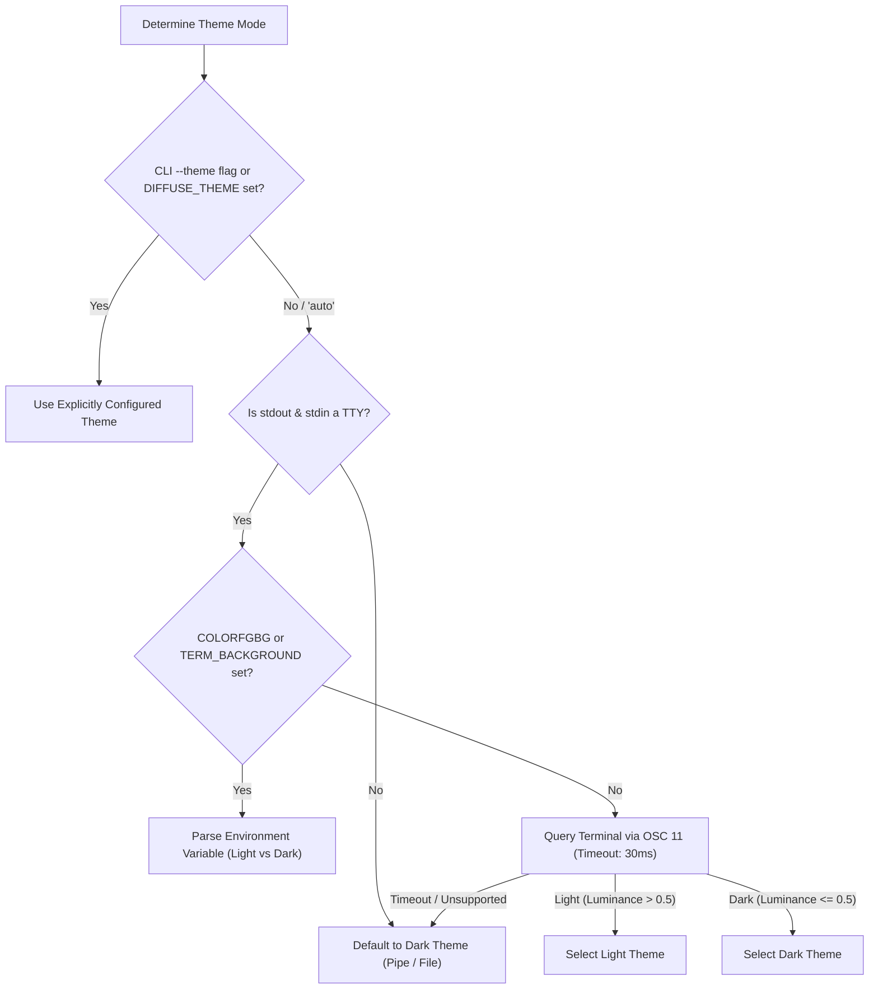

# Light Theme & Automatic Terminal Mode Detection

- [x] **Phase 1: Architectural Refactoring & Semantic Palette Centralization**
  - [x] Expand `ThemePalette` in `crates/diffuse-render/src/theme/palette.rs` with explicit UI semantic roles (UI text, borders, header accents, status bar, and modal chrome)
  - [x] Add theme-aware mod-count styling in `crates/diffuse-render/src/counts.rs` (`count_color_themed`, `count_cells_themed`) and deprecate hardcoded ANSI 256 colors
  - [x] Refactor `ThemePalette::syntax_token_color` to remove hardcoded pastel colors for `RowKind::Add` and `RowKind::Del`, delegating to palette-configured token mappings
  - [x] Deprecate hardcoded ANSI escape sequences in `DiffuseTheme::fallback_named_color` in `crates/diffuse-render/src/theme.rs`
  - [x] Verify byte-for-byte identity of existing dark theme outputs and golden acceptance tests

- [x] **Phase 2: Light Theme Palette & Calibrated Styling Definition**
  - [x] Author `ThemePalette::light_palette()` adhering to WCAG AA ($\ge 4.5:1$) contrast ratios for all syntactic and structural tokens
  - [x] Expose `DiffuseTheme::LIGHT` alongside `DiffuseTheme::DEFAULT` in `crates/diffuse-render/src/theme.rs`
  - [x] Author unit tests in `crates/diffuse-render/src/theme/tests.rs` validating contrast ratios, field differentiation, and complete semantic coverage
- [x] **Phase 3: TUI View Layer Theme Plumbing Refactoring**
  - [x] Refactor `crates/diffuse-tui/src/view/header.rs` (`header_bar_line_themed`, `status_bar_line`, `bottom_ribbon_lines`) to consume palette colors instead of hardcoded ANSI indices
  - [x] Refactor `crates/diffuse-tui/src/view/status_layout.rs` (`StatusSegment`) to store `ratatui::style::Color` derived from the active theme
  - [x] Refactor `crates/diffuse-tui/src/view/modals.rs` to replace hardcoded dark colors and `DiffuseTheme::DEFAULT` references with active `AppState.theme`
  - [x] Refactor `crates/diffuse-tui/src/editor.rs` to pass active theme colors to the markdown editor highlighter
  - [x] Remove hidden `DiffuseTheme::from_env()` calls within view rendering paths in `crates/diffuse-tui/src/view/diff_grid.rs`
- [x] **Phase 4: Terminal Color & Mode Detection Subsystem**
  - [x] Implement `TerminalMode` enum (`Dark`, `Light`) and detection engine in `crates/diffuse-render/src/theme/detect.rs`
  - [x] Implement environment variable fallback detection (`COLORFGBG`, `TERM_BACKGROUND`, `DIFFUSE_THEME`)
  - [x] Implement dynamic terminal background color query via OSC 11 with bounded non-blocking timeout ($\le 30\text{ms}$) and RAII terminal mode guard
  - [x] Calculate perceived relative luminance using sRGB ITU-R BT.709 / WCAG formula ($Y = 0.2126R + 0.7152G + 0.0722B$)
  - [x] Add unit tests for `COLORFGBG` parsing, OSC 11 response parsing, and luminance calculations in `crates/diffuse-render/src/theme/tests.rs`
- [x] **Phase 5: CLI Integration & Auto Mode Default**
  - [x] Update `DiffuseTheme::from_name` to recognize `"light"`, `"white"`, `"dark"`, `"black"`, and `"auto"`
  - [x] Update `DiffuseTheme::from_env` and `crates/diffuse/src/main.rs::resolve_theme` to support `--theme auto` as the default CLI mode
  - [x] Update CLI clap documentation and flag descriptions in `crates/diffuse/src/main.rs`
  - [x] Author CLI integration tests for theme resolution flags in `crates/diffuse/src/main_tests.rs`
- [x] **Phase 6: Interactive TUI Theme Switching & Keybinding**
  - [x] Add `TuiCommand::ToggleTheme` command mapped to key `'T'` / `Shift+T` / `Ctrl+t` in `crates/diffuse-tui/src/command.rs` and `event.rs`
  - [x] Implement theme toggling and visual frame repainting in `crates/diffuse-tui/src/app/dispatch.rs`
  - [x] Update navigation ribbon and help modal (`?`) to document the theme toggle keybinding
  - [x] Author TUI unit tests for runtime theme toggling and modal theme propagation in `crates/diffuse-tui/src/app/tests.rs`
- [x] **Phase 7: Golden Verification & Documentation**
  - [x] Ensure existing golden acceptance baselines (`tests/golden/`) remain 100% byte-identical under the default dark theme
  - [x] Author targeted light-mode rendering tests in `crates/diffuse-render/` and `crates/diffuse-tui/`
  - [x] Update documentation in `README.md` and user guides
  - [x] Execute `scripts/check.sh` verification gate with zero warnings


---

## Executive Summary

*diffuse* provides an interactive TUI reviewer and terminal diff pretty-printer styled through a centralized 256-color and 24-bit RGB palette ([`crates/diffuse-render/src/theme/palette.rs`](file:///home/daniel/lab/diffuse/crates/diffuse-render/src/theme/palette.rs)). The current default theme (`DiffuseTheme::DEFAULT`) is optimized exclusively for dark terminal emulators, utilizing low-luminance backgrounds (`#121212` / ANSI 233) and light foregrounds. When executed in terminal emulators configured with a light background (such as Apple Terminal default, Alacritty light profiles, or iTerm2 light presets), contrast drops significantly, rendering context lines, deletion tints, and line numbers illegible.

A simple addition of a light palette without architectural refactoring would cause substantial system degradation:
1. **Hardcoded ANSI color indices** are scattered across UI modules (`diffuse-tui/src/view/header.rs`, `diffuse-tui/src/view/modals.rs`, `diffuse-tui/src/editor.rs`, and `diffuse-render/src/counts.rs`), rendering UI text, badges, ribbons, and modals with fixed dark-mode tints regardless of the active theme.
2. **Hidden theme lookups**: View rendering functions bypass the application state, invoking `DiffuseTheme::from_env()` or hardcoding `DiffuseTheme::DEFAULT` internally, breaking runtime theme switching.
3. **Hardcoded token tints**: `ThemePalette::syntax_token_color` embeds fixed ANSI 256 colors for modified line additions and deletions, preventing light-palette calibration from reaching diff row tokens.

This engineering plan defines a comprehensive architectural refactoring to eliminate color coupling and centralize all styling under `ThemePalette`, alongside the implementation of `DiffuseTheme::LIGHT`, dynamic terminal background luminance detection (OSC 11 + `COLORFGBG`), and interactive runtime theme toggling.

All existing terminal output baselines ([`tests/golden/`](file:///home/daniel/lab/diffuse/tests/golden/)) remain byte-for-byte unaffected under the default dark configuration.

---

## Table of Contents

1. [Phase 1: Architectural Refactoring & Semantic Palette Centralization](#1-phase-1-architectural-refactoring--semantic-palette-centralization)
2. [Phase 2: Light Theme Palette & Calibrated Styling Definition](#2-phase-2-light-theme-palette--calibrated-styling-definition)
3. [Phase 3: TUI View Layer Theme Plumbing Refactoring](#3-phase-3-tui-view-layer-theme-plumbing-refactoring)
4. [Phase 4: Terminal Color & Mode Detection Subsystem](#4-phase-4-terminal-color--mode-detection-subsystem)
5. [Phase 5: CLI Integration & Auto Mode Default](#5-phase-5-cli-integration--auto-mode-default)
6. [Phase 6: Interactive TUI Theme Switching & Keybinding](#6-phase-6-interactive-tui-theme-switching--keybinding)
7. [Phase 7: Golden Verification & Documentation](#7-phase-7-golden-verification--documentation)

---

## 1. Phase 1: Architectural Refactoring & Semantic Palette Centralization

- **Goal**: Eliminate hardcoded ANSI color constants in `diffuse-render`, decouple syntax token tinting from hardcoded arrays, centralize mod-count styling under `ThemePalette`, and preserve existing dark theme golden outputs.
- **Affected Files**:
  - [`crates/diffuse-render/src/theme/palette.rs`](file:///home/daniel/lab/diffuse/crates/diffuse-render/src/theme/palette.rs)
  - [`crates/diffuse-render/src/theme.rs`](file:///home/daniel/lab/diffuse/crates/diffuse-render/src/theme.rs)
  - [`crates/diffuse-render/src/counts.rs`](file:///home/daniel/lab/diffuse/crates/diffuse-render/src/counts.rs)
  - [`crates/diffuse-render/src/diff.rs`](file:///home/daniel/lab/diffuse/crates/diffuse-render/src/diff.rs)
  - [`crates/diffuse-render/src/theme/tests.rs`](file:///home/daniel/lab/diffuse/crates/diffuse-render/src/theme/tests.rs)

### Problem Analysis & Refactoring Strategy

Currently, multiple rendering paths bypass the palette or hardcode colors:
1. **Mod Counts**: [`crates/diffuse-render/src/counts.rs`](file:///home/daniel/lab/diffuse/crates/diffuse-render/src/counts.rs) hardcodes fixed ANSI indices:
   ```rust
   pub fn count_color(kind: CountKind) -> u8 {
       match kind {
           CountKind::Dels => 203,
           CountKind::Adds => 120,
           CountKind::Mods => 214,
           CountKind::Movs => 147,
           CountKind::Notes => 220,
       }
   }
   ```
   On a light background, ANSI 120 (light lime green) and ANSI 220 (light gold) have insufficient contrast against white ($\approx 1.3:1$, failing WCAG AA).
2. **Syntax Token Tinting in Modified Lines**: `ThemePalette::syntax_token_color` hardcodes fixed ANSI colors in the `RowKind::Add` and `RowKind::Del` match arms (e.g. `Color::Fixed(221)`, `Color::Fixed(147)`, `Color::Fixed(215)`), ignoring palette fields.
3. **Missing UI Semantic Roles**: `ThemePalette` does not define fields for status bar segments, modal dialog backgrounds, modal borders, or navigation ribbons.

### Actions
1. **Expand `ThemePalette` with Complete UI Semantic Roles**:
   ```rust
   pub struct ThemePalette {
       // ... existing fields ...
       
       // UI & Status Bar
       pub status_bar_bg: Color,
       pub status_bar_fg: Color,
       pub status_bar_dim: Color,
       pub status_bar_accent: Color,
       pub ribbon_divider: Color,
       pub ribbon_text: Color,
       
       // Modals & Overlays
       pub modal_bg: Color,
       pub modal_border: Color,
       pub modal_title: Color,
       pub modal_text: Color,
       pub modal_dim: Color,
       pub modal_selected_bg: Color,
       pub modal_selected_fg: Color,
       
       // Count Highlights (theme-specific)
       pub count_dels: Color,
       pub count_adds: Color,
       pub count_mods: Color,
       pub count_movs: Color,
       pub count_notes: Color,
       
       // Row Syntax Overrides
       pub add_syntax_token: TokenColorOverride,
       pub del_syntax_token: TokenColorOverride,
   }
   ```
2. **Make Mod Counts Theme-Aware**:
   - Introduce `count_color_themed(kind: CountKind, palette: &ThemePalette) -> Color`.
   - Introduce `count_cells_themed(counts: &FileCounts, palette: &ThemePalette) -> SmallVec<[ThemedCountCell; 5]>`.
   - Retain `count_color(kind) -> u8` and `count_cells(counts)` as compatibility wrappers using `ThemePalette::default_palette()` so non-themed call sites compile without disruption.
3. **Decouple `syntax_token_color`**:
   - Refactor `syntax_token_color(&self, color: &str, row_kind: RowKind) -> Option<Color>` to query palette-configured token mappings (`self.add_syntax_token` and `self.del_syntax_token`) rather than hardcoded fixed colors.
   - For `ThemePalette::default_palette()`, assign the exact ANSI color indices previously hardcoded, ensuring zero regression on golden outputs.
4. **Deprecate Hardcoded ANSI Escapes in `fallback_named_color`**:
   - Replace literal ANSI escapes (`\x1b[38;5;120m`, `\x1b[48;2;76;64;20m`) with palette resolution: `self.palette.named_color(name).map(|c| c.fg_code())`.

---

## 2. Phase 2: Light Theme Palette & Calibrated Styling Definition

- **Goal**: Author `ThemePalette::light_palette()` adhering to the exact semantic color schema of `ThemePalette`, and expose `DiffuseTheme::LIGHT`.
- **Affected Files**:
  - [`crates/diffuse-render/src/theme/palette.rs`](file:///home/daniel/lab/diffuse/crates/diffuse-render/src/theme/palette.rs)
  - [`crates/diffuse-render/src/theme.rs`](file:///home/daniel/lab/diffuse/crates/diffuse-render/src/theme.rs)
  - [`crates/diffuse-render/src/theme/tests.rs`](file:///home/daniel/lab/diffuse/crates/diffuse-render/src/theme/tests.rs)

### Design & Contrast Principles

Light backgrounds require inverted luminance contrast compared to dark palettes:
- **Base Canvas**: Soft, clean light tone to avoid harsh glare:
  - `bg_base: Color::Rgb(250, 250, 250)`
  - `bg_modal: Color::Rgb(242, 242, 244)`
  - `border: Color::Rgb(185, 190, 198)`
  - `ctx_fg: Color::Rgb(36, 41, 47)` (dark charcoal for crisp text contrast $\ge 12:1$)
  - `band_bg: Color::Rgb(243, 245, 248)`
  - `ctx_cursor_bg: Color::Rgb(232, 235, 240)`
- **Diff Additions (Green)**:
  - `add_tint_bg: Color::Rgb(230, 246, 236)` (subtle light mint background)
  - `add_cursor_bg: Color::Rgb(205, 238, 215)`
  - `add_fill_bg: Color::Rgb(172, 224, 186)` (prominent subline token fill)
  - `add_fill_cursor_bg: Color::Rgb(145, 210, 162)`
  - `add_fg: Color::Rgb(26, 127, 55)` (deep forest green for WCAG AA text contrast $\ge 4.5:1$)
- **Diff Deletions (Red)**:
  - `del_tint_bg: Color::Rgb(255, 235, 236)` (subtle light coral background)
  - `del_cursor_bg: Color::Rgb(255, 212, 215)`
  - `del_fill_bg: Color::Rgb(255, 178, 184)` (prominent subline token fill)
  - `del_fill_cursor_bg: Color::Rgb(255, 150, 158)`
  - `del_fg: Color::Rgb(207, 34, 46)` (deep crimson red for WCAG AA text contrast $\ge 4.5:1$)
- **Diff Modifications & Relocations**:
  - `mod_tint_bg: Color::Rgb(245, 245, 247)`
  - `mod_cursor_bg: Color::Rgb(230, 232, 236)`
  - `mod_fill_bg: Color::Rgb(172, 224, 186)`
  - `mod_fill_cursor_bg: Color::Rgb(145, 210, 162)`
  - `mod_fg: Color::Rgb(36, 41, 47)`
  - `mov_tint_bg: Color::Rgb(244, 240, 255)` (subtle lavender)
  - `mov_cursor_bg: Color::Rgb(230, 222, 252)`
  - `mov_fg: Color::Rgb(90, 45, 160)` (deep purple)
- **Review Notes**:
  - `note_tint_bg: Color::Rgb(254, 248, 225)` (warm parchment)
  - `note: Color::Rgb(150, 95, 0)` (warm amber)
  - `warning: Color::Rgb(180, 80, 0)`
- **Counts Highlights (Light Mode)**:
  - `count_dels: Color::Rgb(207, 34, 46)` (crisp crimson)
  - `count_adds: Color::Rgb(26, 127, 55)` (crisp forest green)
  - `count_mods: Color::Rgb(170, 90, 0)` (sienna amber)
  - `count_movs: Color::Rgb(110, 40, 130)` (plum violet)
  - `count_notes: Color::Rgb(150, 95, 0)` (warm amber)
- **Banners & UI Headers**:
  - `file_header_bg_selected: Color::Rgb(215, 228, 250)`
  - `file_header_bg_current: Color::Rgb(228, 236, 248)`
  - `file_header_bg_rest: Color::Rgb(240, 243, 248)`
  - `file_header_fg_selected: Color::Rgb(15, 60, 140)`
  - `file_header_fg_current: Color::Rgb(25, 75, 160)`
  - `file_header_fg_rest: Color::Rgb(60, 80, 110)`
  - `file_header_path_selected: Color::Rgb(5, 25, 65)`
  - `file_header_path_current: Color::Rgb(15, 35, 75)`
  - `file_header_path_rest: Color::Rgb(35, 50, 80)`
  - `hunk_divider_bg_selected: Color::Rgb(225, 225, 238)`
  - `hunk_divider_bg_current: Color::Rgb(238, 238, 246)`
  - `hunk_divider_bg_rest: Color::Primary`
  - `hunk_divider_fg: Color::Rgb(110, 40, 130)`
  - `hunk_divider_fg_selected: Color::Rgb(140, 45, 165)`
  - `header_bar_bg: Color::Rgb(235, 238, 242)`
  - `header_bar_fg: Color::Rgb(36, 41, 47)`
  - `scrollbar_thumb: Color::Rgb(180, 185, 195)`
  - `scrollbar_track: Color::Rgb(240, 242, 245)`
- **Syntax Highlighting (Light Background Calibrated)**:
  - `syntax_keyword: Color::Rgb(170, 20, 120)` (rich magenta)
  - `syntax_type: Color::Rgb(15, 110, 130)` (deep teal)
  - `syntax_function: Color::Rgb(10, 85, 185)` (cobalt blue)
  - `syntax_number: Color::Rgb(165, 75, 0)` (sienna orange)
  - `syntax_string: Color::Rgb(20, 115, 40)` (dark emerald)
  - `add_syntax_string: Color::Rgb(20, 115, 40)`
  - `del_syntax_string: Color::Rgb(180, 30, 40)`
  - `syntax_comment: Color::Rgb(105, 115, 130)` (muted slate)
  - `syntax_operator: Color::Rgb(65, 75, 90)` (graphite)
- **Markdown Tokens**:
  - `md_bold: Color::Rgb(180, 75, 0)`
  - `md_italic: Color::Rgb(125, 60, 150)`
  - `md_strike: Color::Rgb(130, 135, 145)`
  - `md_link: Color::Rgb(10, 85, 185)`
  - `md_url: Color::Rgb(100, 105, 115)`
  - `md_delim: Color::Rgb(15, 110, 130)`
  - `md_rule: Color::Rgb(185, 190, 200)`

### Actions
1. Implement `ThemePalette::light_palette() -> Self` in [`crates/diffuse-render/src/theme/palette.rs`](file:///home/daniel/lab/diffuse/crates/diffuse-render/src/theme/palette.rs).
2. Define `DiffuseTheme::LIGHT` in [`crates/diffuse-render/src/theme.rs`](file:///home/daniel/lab/diffuse/crates/diffuse-render/src/theme.rs).
3. Author unit tests asserting that all palette fields differ between dark and light themes, and that relative contrast thresholds ($\ge 4.5:1$) are preserved for text tokens.

---

## 3. Phase 3: TUI View Layer Theme Plumbing Refactoring

- **Goal**: Refactor `diffuse-tui` to eliminate hardcoded ANSI colors, thread the active `DiffuseTheme` through all rendering entry points, and eliminate rogue calls to `DiffuseTheme::DEFAULT` or `DiffuseTheme::from_env()`.
- **Affected Files**:
  - [`crates/diffuse-tui/src/view/header.rs`](file:///home/daniel/lab/diffuse/crates/diffuse-tui/src/view/header.rs)
  - [`crates/diffuse-tui/src/view/status_layout.rs`](file:///home/daniel/lab/diffuse/crates/diffuse-tui/src/view/status_layout.rs)
  - [`crates/diffuse-tui/src/view/modals.rs`](file:///home/daniel/lab/diffuse/crates/diffuse-tui/src/view/modals.rs)
  - [`crates/diffuse-tui/src/editor.rs`](file:///home/daniel/lab/diffuse/crates/diffuse-tui/src/editor.rs)
  - [`crates/diffuse-tui/src/view/diff_grid.rs`](file:///home/daniel/lab/diffuse/crates/diffuse-tui/src/view/diff_grid.rs)
  - [`crates/diffuse-tui/src/app/render.rs`](file:///home/daniel/lab/diffuse/crates/diffuse-tui/src/app/render.rs)

### Problem Analysis & Refactoring Strategy

1. **Header Bar Color Hardcoding**:
   In [`crates/diffuse-tui/src/view/header.rs`](file:///home/daniel/lab/diffuse/crates/diffuse-tui/src/view/header.rs):
   `header_bar_line_themed` accepts `theme: &DiffuseTheme`, but currently ignores it and hardcodes:
   - Repo: `Color::Indexed(117)`
   - Glyphs: `Color::Indexed(244)`
   - Branch: `Color::Indexed(252)`
   - Staged tag: `Color::Indexed(120)`
   - Prefix: `Color::Indexed(152)`
   - Bottom ribbon: `Color::Indexed(244)`
   These must be refactored to use `theme.palette.accent`, `theme.palette.muted`, `theme.palette.header_bar_fg`, etc., converted via `to_color(...)`.
2. **Status Layout Segments**:
   In [`crates/diffuse-tui/src/view/status_layout.rs`](file:///home/daniel/lab/diffuse/crates/diffuse-tui/src/view/status_layout.rs):
   `StatusSegment` stores `pub color: u8` and hardcodes indices `220` (gold) and `240` (gray).
   Refactor `StatusSegment` to store `ratatui::style::Color` (or `yansi::Color`), resolving colors via the active theme:
   ```rust
   pub struct StatusSegment {
       pub text: String,
       pub color: ratatui::style::Color,
       pub bold: bool,
   }
   ```
   Update `status_layout(ctx: &StatusBarContext<'_>, theme: &DiffuseTheme)` to pass `theme`.
3. **Modal Views**:
   In [`crates/diffuse-tui/src/view/modals.rs`](file:///home/daniel/lab/diffuse/crates/diffuse-tui/src/view/modals.rs):
   Lines 373 and 573 hardcode `&DiffuseTheme::DEFAULT` when rendering line-number selection and note range previews. Furthermore, modal borders (`Color::Indexed(240)`), titles (`Color::Indexed(231)`), and backgrounds (`Color::Indexed(236)` / `239`) are hardcoded.
   Refactor all modal renderers to accept `theme: &DiffuseTheme` and apply `theme.palette.modal_bg`, `theme.palette.modal_border`, `theme.palette.modal_title`, and `theme.palette.modal_text`.
4. **Editor Highlighting**:
   In [`crates/diffuse-tui/src/editor.rs`](file:///home/daniel/lab/diffuse/crates/diffuse-tui/src/editor.rs):
   Lines 824 and 890 hardcode `Color::Indexed(231)` (bright white) for cursor / text.
   Refactor `markdown_highlighter(theme: DiffuseTheme)` to style text and cursor using `theme.palette.ctx_fg` and `theme.palette.bg_base`.
5. **Eliminate Hidden Theme Lookups**:
   Search and remove all occurrences of `DiffuseTheme::from_env()` in `crates/diffuse-tui/src/view/`. All views must receive the theme from `AppState.theme` (or caller argument).

---

## 4. Phase 4: Terminal Color & Mode Detection Subsystem

- **Goal**: Implement dynamic, non-intrusive terminal background detection in `diffuse-render`.
- **Affected Files**:
  - `crates/diffuse-render/src/theme/detect.rs` (new module)
  - `crates/diffuse-render/src/theme.rs`
  - `crates/diffuse-render/Cargo.toml`
  - `crates/diffuse-render/src/theme/tests.rs`

### Detection Architecture & Cascade

Detection proceeds through four prioritized evaluation tiers:



#### Tier 1: Explicit Override
- If `--theme <name>` CLI parameter or `DIFFUSE_THEME` environment variable is set to `"light"` / `"white"`, return `DiffuseTheme::LIGHT`.
- If set to `"dark"`, `"black"`, or `"default"`, return `DiffuseTheme::DEFAULT`.
- If set to `"auto"` (or unset), continue to automated detection.

#### Tier 2: Non-TTY Guard
- If stdout or stdin is not a TTY (for example, piped to a file or another process), bypass terminal control sequences immediately and default to `DiffuseTheme::DEFAULT`.

#### Tier 3: Environment Indicators (`COLORFGBG`, `TERM_BACKGROUND`)
- `TERM_BACKGROUND`: `"light"` $\to$ Light; `"dark"` $\to$ Dark.
- `COLORFGBG`: Standard format is `"foreground;background"` (or `"fg;extra;bg"`).
  - Extract the final integer: `let bg = parts.last()?.parse::<u8>().ok()?`.
  - Standard ANSI conventions:
    - `0..=6 | 8` $\to$ Dark backgrounds (Black, Red, Green, Yellow, Blue, Magenta, Cyan, Gray).
    - `7 | 11..=15` $\to$ Light backgrounds (Light Gray, Light Yellow, Light Cyan, White).

#### Tier 4: Dynamic OSC 11 Background Query
- Send OSC 11 query sequence to the controlling terminal: `\x1b]11;?\x1b\\` (compatible with xterm, tmux, Alacritty, iTerm2, Kitty, Ghostty, Foot, Windows Terminal).
- Put the terminal into raw mode using an RAII drop guard that guarantees the original terminal mode is restored even on panic or error.
- Read response with a bounded timeout (max 30ms) to ensure zero perceptible lag:
  - Expected response format: `\x1b]11;rgb:rrrr/gggg/bbbb\x1b\\` (where color components are 1 to 4 hexadecimal digits).
- Convert 16-bit RGB values to normalized $[0.0, 1.0]$ floating-point values:
  $$R = \frac{r}{65535}, \quad G = \frac{g}{65535}, \quad B = \frac{b}{65535}$$
- Calculate perceived luminance via the ITU-R BT.709 / WCAG relative luminance formula:
  $$Y = 0.2126 R + 0.7152 G + 0.0722 B$$
- Classification invariant:
  - If $Y > 0.5$: Terminal background is **Light** $\implies$ return `DiffuseTheme::LIGHT`.
  - If $Y \le 0.5$: Terminal background is **Dark** $\implies$ return `DiffuseTheme::DEFAULT`.
- If the terminal does not respond within 30ms or emits an invalid response, fail cleanly and default to `DiffuseTheme::DEFAULT`.

### Actions
1. Create `crates/diffuse-render/src/theme/detect.rs` containing:
   - `enum TerminalMode { Dark, Light }`
   - `fn detect_terminal_mode() -> Option<TerminalMode>`
   - `fn parse_colorfgbg(val: &str) -> Option<TerminalMode>`
   - `fn parse_osc11_response(resp: &str) -> Option<(u16, u16, u16)>`
   - `fn relative_luminance(r: u16, g: u16, b: u16) -> f64`
2. Integrate `TerminalMode::detect()` into `DiffuseTheme::from_env()`.
3. Add unit tests verifying `COLORFGBG` parsing across edge cases and OSC 11 hexadecimal parsing (1-digit, 2-digit, 4-digit hex strings).

---

## 5. Phase 5: CLI Integration & Auto Mode Default

- **Goal**: Expose `--theme auto` as the default theme mode in the CLI and wire resolver logic.
- **Affected Files**:
  - [`crates/diffuse/src/main.rs`](file:///home/daniel/lab/diffuse/crates/diffuse/src/main.rs)
  - [`crates/diffuse/src/main_tests.rs`](file:///home/daniel/lab/diffuse/crates/diffuse/src/main_tests.rs)
  - [`crates/diffuse-render/src/theme.rs`](file:///home/daniel/lab/diffuse/crates/diffuse-render/src/theme.rs)

### Actions
1. Update `DiffuseTheme::from_name`:
   ```rust
   pub fn from_name(name: &str) -> Option<Self> {
       match name.trim().to_lowercase().as_str() {
           "default" | "dark" | "black" => Some(Self::DEFAULT),
           "light" | "white" => Some(Self::LIGHT),
           "auto" => Some(Self::auto_detect()),
           _ => None,
       }
   }
   ```
2. Update [`crates/diffuse/src/main.rs`](file:///home/daniel/lab/diffuse/crates/diffuse/src/main.rs):
   - Change CLI help docstring for `--theme`:
     `"Color theme ('auto', 'default'/'dark', 'light'). Defaults to 'auto', selecting based on terminal background mode."`
   - Update `resolve_theme(cli_theme: Option<&str>)`:
     - If `--theme` is specified: resolve name or warn and fall back.
     - If `--theme` is not specified: check `DIFFUSE_THEME` env var, falling back to `DiffuseTheme::auto_detect()`.
3. Author CLI integration tests in [`crates/diffuse/src/main_tests.rs`](file:///home/daniel/lab/diffuse/crates/diffuse/src/main_tests.rs):
   - Test `resolve_theme(Some("light")) == DiffuseTheme::LIGHT`.
   - Test `resolve_theme(Some("dark")) == DiffuseTheme::DEFAULT`.
   - Test `resolve_theme(Some("auto"))` executes detection logic without panicking.

---

## 6. Phase 6: Interactive TUI Theme Switching & Keybinding

- **Goal**: Enable interactive switching between Light and Dark themes directly within the TUI reviewer without restarting.
- **Affected Files**:
  - [`crates/diffuse-tui/src/command.rs`](file:///home/daniel/lab/diffuse/crates/diffuse-tui/src/command.rs)
  - [`crates/diffuse-tui/src/keymap.rs`](file:///home/daniel/lab/diffuse/crates/diffuse-tui/src/keymap.rs)
  - [`crates/diffuse-tui/src/app.rs`](file:///home/daniel/lab/diffuse/crates/diffuse-tui/src/app.rs)
  - [`crates/diffuse-tui/src/app/dispatch.rs`](file:///home/daniel/lab/diffuse/crates/diffuse-tui/src/app/dispatch.rs)
  - [`crates/diffuse-tui/src/app/tests.rs`](file:///home/daniel/lab/diffuse/crates/diffuse-tui/src/app/tests.rs)
  - [`crates/diffuse-tui/src/view/header.rs`](file:///home/daniel/lab/diffuse/crates/diffuse-tui/src/view/header.rs)

### Keybinding & Command Mapping

- Add `TuiCommand::ToggleTheme` to [`crates/diffuse-tui/src/command.rs`](file:///home/daniel/lab/diffuse/crates/diffuse-tui/src/command.rs).
- In [`crates/diffuse-tui/src/keymap.rs`](file:///home/daniel/lab/diffuse/crates/diffuse-tui/src/keymap.rs), map key `'t'` (or `'T'`) to `TuiCommand::ToggleTheme`.
- In [`crates/diffuse-tui/src/app/dispatch.rs`](file:///home/daniel/lab/diffuse/crates/diffuse-tui/src/app/dispatch.rs):
  ```rust
  TuiCommand::ToggleTheme => {
      self.theme = if self.theme == DiffuseTheme::LIGHT {
          DiffuseTheme::DEFAULT
      } else {
          DiffuseTheme::LIGHT
      };
      self.bump_content();
  }
  ```
- Because all view rendering functions ([`crates/diffuse-tui/src/app/render.rs`](file:///home/daniel/lab/diffuse/crates/diffuse-tui/src/app/render.rs), [`crates/diffuse-tui/src/view/diff_grid.rs`](file:///home/daniel/lab/diffuse/crates/diffuse-tui/src/view/diff_grid.rs), and [`crates/diffuse-tui/src/view/modals.rs`](file:///home/daniel/lab/diffuse/crates/diffuse-tui/src/view/modals.rs)) now receive `&self.theme` without hardcoding, toggling `self.theme` instantly updates the next rendered frame without tearing or re-evaluating git diff state.
- Update header bar help legend in [`crates/diffuse-tui/src/view/header.rs`](file:///home/daniel/lab/diffuse/crates/diffuse-tui/src/view/header.rs) and the help modal (`?`) to list `[t]theme`.

---

## 7. Phase 7: Golden Verification & Documentation

- **Goal**: Verify backward compatibility with the locked golden corpus, validate test performance budgets, and document the new theme capabilities.
- **Affected Files**:
  - [`tests/golden.rs`](file:///home/daniel/lab/diffuse/tests/golden.rs)
  - [`README.md`](file:///home/daniel/lab/diffuse/README.md)
  - [`crates/diffuse-render/src/lib.rs`](file:///home/daniel/lab/diffuse/crates/diffuse-render/src/lib.rs)

### Quality Invariants & Verification Gates

1. **Dual Acceptance Legs & Golden Immutability**:
   - [`tests/golden.rs`](file:///home/daniel/lab/diffuse/tests/golden.rs) verifies that all frozen `.render.txt`, `.wire.jsonl`, and `.markdown.md` outputs remain byte-identical under the default dark theme.
   - The default theme definition must not alter any RGB values or ANSI color codes in `DiffuseTheme::DEFAULT`.
2. **Performance Budgets**:
   - Terminal background detection query must complete in $< 30\text{ ms}$ on interactive startup.
   - All unit tests across `diffuse-render` and `diffuse-tui` must execute in $< 0.5\text{ s}$ per test.
   - The full verification gate (`scripts/check.sh`) must complete cleanly with zero warnings.
3. **Documentation**:
   - Update `README.md` with theme options: `--theme auto|dark|light` and `DIFFUSE_THEME`.
   - Mention the `[t]` interactive keybinding in the TUI reviewer guide.
