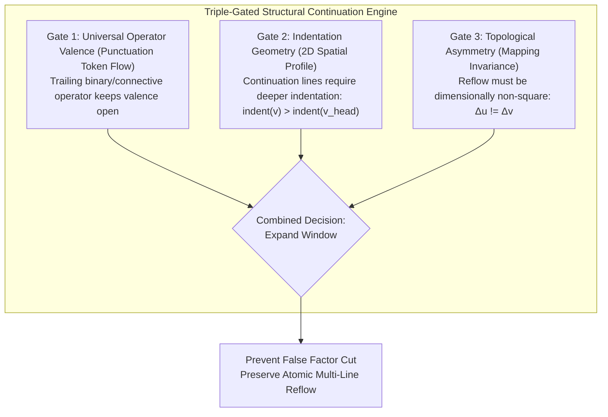

# Structural Continuation and Punctuation Valence in Cluster Factoring — Engineering Plan

- [ ] Phase 1 — Universal Operator Valence in Delimiter Tracking (`crates/diffuse-core/src/cluster/factor.rs`)
- [ ] Phase 2 — Indentation Geometry and Continuation Depth Profile (`crates/diffuse-core/src/cluster/factor.rs`)
- [ ] Phase 3 — Topologically Asymmetric Reflow Gating ($\Delta u \ne \Delta v$) (`crates/diffuse-core/src/cluster/factor.rs`)
- [ ] Phase 4 — Unified Triple-Gate Integration & Elimination of Ad-Hoc Syntax Awareness (`crates/diffuse-core/src/cluster/factor.rs`)
- [ ] Phase 5 — Golden Corpus Calibration, Regression Baseline & Sign-Off (`tests/golden/`)

---

## 1. Executive Summary

In structured diff analysis, the cluster factoring engine in [`crates/diffuse-core/src/cluster/factor.rs`](crates/diffuse-core/src/cluster/factor.rs) decomposes large modification clusters into cohesive, atomic factor groups prior to micro-DP alignment. When code undergoes a multi-line refactor, an expression head often occupies its own line, severed from its right-hand side (RHS) expression:

```rust
// Old:
let mut matched: usize = 0;
for j in pairs.values() {
    matched += nt_token_chars[*j];
}

// New:
let matched =
    crate::lcs::lcs_matched_chars_ids(&ot.ids, nt_ids, ws, alnum, nt_token_chars, scratch);
```

Under line-level bilateral token matching, the assignment head line `let matched =` shares high bilateral salience ($\mathcal{E} \approx 1.0$) with `let mut matched = 0;`. Because traditional factoring closure loops only expand across intersecting (crossing) edges or unbalanced delimiter brackets (`()[]{}`), the head line $(u_1, v_1) = (1, 0)$ and its body edge $(u_3, v_2) = (3, 1)$ do not cross. Left ungated, the factoring walk severs the assignment head from its RHS body into separate groups.

A stopgap approach relies on language syntax awareness via string checks (e.g. `is_open_continuation_line`, inspecting whether a line ends with `= `, `=>`, or `->`). However, language-specific syntactic rules violate the architectural invariant of a language-agnostic analysis engine and fail on languages with different operator vocabularies. Conversely, naive graph-theoretic chaining based on shared identifiers creates a **Common Identifier Trap**: in unit test suites or repetitive methods, unrelated assertions referencing identical variables (e.g. `state`, `assert_eq`, `layout`) are erroneously chained into giant clusters.

This plan combines three complementary, language-agnostic physical and information-theoretic principles to maintain atomic multi-line expression reflows without lexical string heuristics:



### Mathematical Invariants and Architectural Principles

1. **Operator Valence as Open Container State**:
   Just as parentheses `()`, brackets `[]`, and braces `{}` induce depth state in [`robust_delim_delta`](crates/diffuse-core/src/cluster/factor.rs), trailing infix and connective punctuation (`=`, `+`, `-`, `*`, `/`, `&&`, `||`, `.`, `,`) function as unclosed valence operators. In formal language theory, an infix operator requires both LHS and RHS operands; a line terminating in an operator has unsatisfied valence:
   $$\text{Valence}(L) = \begin{cases} +1 & \text{if } \text{last\_token}(L) \in \text{BinaryOperators} \\ 0 & \text{otherwise} \end{cases}$$
2. **Indentation Geometry Invariant**:
   Multi-line continuation expressions across all structured programming languages exhibit strict geometric hierarchy: continuation lines are indented deeper than the statement head:
   $$\text{Indent}(L_{\text{cont}}) > \text{Indent}(L_{\text{head}})$$
   Lines at the same or lesser indentation represent statement boundaries or sibling items and must not be swallowed.
3. **Topological Asymmetry Invariant ($\Delta u \ne \Delta v$)**:
   In a sequence of independent statements, line progression is symmetric ($\Delta u = \Delta v = 1$). In an expression reflow, the transformation is non-square: an $N$-line block collapses into an $M$-line block ($N \ne M$). Multi-line continuation binding is restricted to asymmetric transitions where:
   $$\Delta u \ne \Delta v \quad\text{or}\quad \text{has\_unbalanced\_valence}(L)$$
   This invariant protects independent $1:1$ statement modifications from chaining together even if they share common domain variables.
4. **Syntactic Domain Preservation**:
   Comment documentation lines (`is_comment_line`) and code implementation lines occupy distinct syntactic domains. Chaining rules must never cross comment/code boundaries.

---

## 2. Table of Contents

1. [Phase 1 — Universal Operator Valence in Delimiter Tracking](#1-phase-1--universal-operator-valence-in-delimiter-tracking)
2. [Phase 2 — Indentation Geometry and Continuation Depth Profile](#2-phase-2--indentation-geometry-and-continuation-depth-profile)
3. [Phase 3 — Topologically Asymmetric Reflow Gating ($\Delta u \ne \Delta v$)](#3-phase-3--topologically-asymmetric-reflow-gating-delta-u-ne-delta-v)
4. [Phase 4 — Unified Triple-Gate Integration & Elimination of Ad-Hoc Syntax Awareness](#4-phase-4--unified-triple-gate-integration--elimination-of-ad-hoc-syntax-awareness)
5. [Phase 5 — Golden Corpus Calibration, Regression Baseline & Sign-Off](#5-phase-5--golden-corpus-calibration-regression-baseline--sign-off)

---

## 3. Phase Breakdown

### 1. Phase 1 — Universal Operator Valence in Delimiter Tracking

#### Problem
In [`crates/diffuse-core/src/cluster/factor.rs`](crates/diffuse-core/src/cluster/factor.rs), [`robust_delim_delta`](crates/diffuse-core/src/cluster/factor.rs#L628) evaluates bracket balance (`(`, `)`, `[`, `]`, `{`, `}`) but ignores trailing binary operators and connective punctuation. Consequently, a line like `let matched =` has $\Delta_{\text{delim}} = 0$, leading the closure loop to assume the line is syntactically closed.

#### Implementation Steps
1. **Define Universal Valence Classifier**:
   In [`crates/diffuse-core/src/cluster/factor.rs`](crates/diffuse-core/src/cluster/factor.rs):
   - Implement `trailing_operator_valence(line: &str) -> i32`.
   - Strip string literals and comments.
   - Detect trailing infix punctuation: `=`, `+`, `-`, `*`, `/`, `%`, `&`, `|`, `^`, `.`, `,`, `=>`, `->`.
   - Reject equality/comparison operators (`==`, `!=`, `<=`, `>=`).
2. **Integrate into Delimiter Depth Walk**:
   Extend the line delta calculation in `factor_cluster_with_content` so that lines with positive valence contribute to the unclosed depth differential `diff = old_depth - new_depth`.
3. **Tests**:
   - Unit tests verifying valence calculation across expressions ending in `=`, `.` (method chain), and `,` (argument list).
   - Negative tests verifying that lines ending in `;`, `)`, `}`, or complete literals have zero valence.

---

### 2. Phase 2 — Indentation Geometry and Continuation Depth Profile

#### Problem
Relying solely on trailing punctuation can over-expand in configurations where lines have trailing commas in data tables or match arms. 2D indentation geometry provides the spatial verification that a succeeding line is subordinate to the preceding head.

#### Implementation Steps
1. **Compute Indentation Column**:
   In [`crates/diffuse-core/src/cluster/factor.rs`](crates/diffuse-core/src/cluster/factor.rs):
   - Implement `line_indent_depth(line: &str) -> usize`, expanding tabs to 4-space equivalents and measuring leading whitespace.
2. **Continuation Indent Verification**:
   When evaluating whether candidate line $v_{\text{end}}$ continues the active statement at $v_{\text{end}} - 1$:
   - Assert $\text{indent}(v_{\text{end}}) > \text{indent}(v_{\text{head}})$.
   - Require that intervening lines are not blank or detached comments.

---

### 3. Phase 3 — Topologically Asymmetric Reflow Gating ($\Delta u \ne \Delta v$)

#### Problem
When multiple statements are modified consecutively, they may share domain variables (e.g. `state.foo(); state.bar();`). If valence or indentation heuristics trigger spuriously, independent statements risk merging into an unreviewable compound group.

#### Implementation Steps
1. **Dimensional Mapping Assessment**:
   For adjacent candidate edges $e_1 = (u_1, v_1)$ and $e_2 = (u_2, v_2)$:
   - Compute $\Delta u = u_2 - u_1$ and $\Delta v = v_2 - v_1$.
   - Symmetric progressions ($\Delta u == \Delta v == 1$) represent 1:1 row modifications and are barred from continuation chaining unless bracket delimiter depth is strictly non-zero.
   - Asymmetric reflows ($\Delta u \ne \Delta v$) signal true dimensionality changes ($N \to M$), authorizing continuation expansion.
2. **Comment Boundary Barrier**:
   Enforce `is_comment_line(old) == is_comment_line(in_old)` and `is_comment_line(new) == is_comment_line(in_new)` to guarantee documentation and code never cross-chain.

---

### 4. Phase 4 — Unified Triple-Gate Integration & Elimination of Ad-Hoc Syntax Awareness

#### Problem
[`is_open_continuation_line`](crates/diffuse-core/src/cluster/factor.rs#L694) in `crates/diffuse-core/src/cluster/factor.rs` is an ad-hoc lexical string check. It must be completely eliminated once the triple-gated system is unified.

#### Implementation Steps
1. **Consolidate Closure Loop Expansion**:
   In `factor_cluster_with_content`:
   - Replace the `is_open_continuation_line` block with the unified triple-gate check:
     $$\text{Expand} \iff (\text{UnsatisfiedValence} \lor \text{UnbalancedDelim}) \land \text{DeeperIndent} \land (\Delta u \ne \Delta v \lor \text{Depth} > 0)$$
2. **Remove Ad-Hoc Function**:
   Delete `fn is_open_continuation_line` entirely from `crates/diffuse-core/src/cluster/factor.rs`.
3. **Run Full Verification Suite**:
   Execute `cargo test -p diffuse-core` (663 unit tests) and assert 100% pass rate.

---

### 5. Phase 5 — Golden Corpus Calibration, Regression Baseline & Sign-Off

#### Implementation Steps
1. **Golden Acceptance Verification**:
   Execute `cargo test -p diffuse --test golden` across all 45 golden tests.
2. **Drift Audit**:
   Verify that:
   - Compound multi-line reflows remain intact.
   - Independent statement progressions remain cleanly factored into 1:1 groups.
   - Golden corpora match expected static baselines or produce strictly superior diff readability.
3. **Verification Gate**:
   Execute `./scripts/check.sh` ensuring zero warnings, nightly format compliance, and dev binary synchronization.
