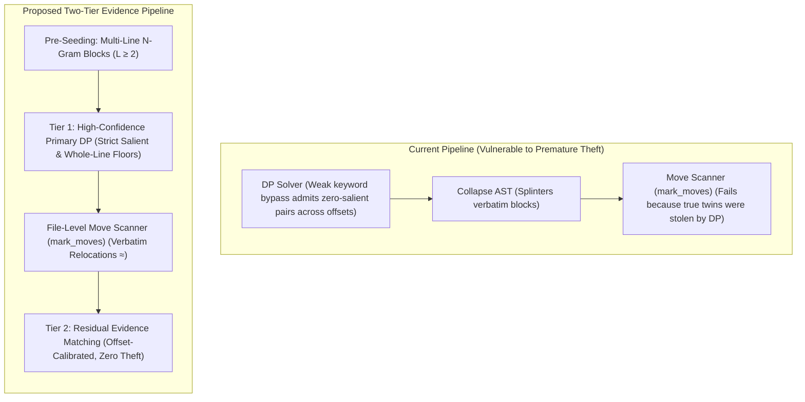

# Two-Tier Pairing and Evidence-Gated Alignment — Engineering Plan

- [x] Phase 1 — Multi-Line Contiguous N-Gram Block Pre-Seeding ($L \ge 2$) (`diffuse-core`)
- [·] Phase 2 — Tier 1 Admission Tightening and Keyword Bypass Elimination (`diffuse-core`)
- [ ] Phase 3 — Affine Diagonal Continuity and Detour Penalization in DP (`diffuse-core`)
- [ ] Phase 4 — Tier 2 Residual Evidence Matching Engine (`diffuse-core`)
- [ ] Phase 5 — Golden Corpus Calibration, Acceptance Verification & Sign-Off

---

## 1. Executive Summary

The `diffuse-core` diff analysis pipeline pairs line-level deletions and additions into unified modification rows (`RowKind::Mod`) and sub-line token alignments. In real-world code refactorings, changes often combine block re-indentation, moved helpers, and localized logic edits.

A critical defect in the current pairing engine arises from **unconditional keyword-only admission**:
The 2D dynamic programming pairing solver admits candidate pairs based on statement head keyword coincidence (`same_indent_head_match`), bypassing the salient similarity floor (`MIN_RATIO_CODE = 0.35`) even when lines share **zero salient tokens** (`matched_salient == 0`).

In large or re-indented blocks (such as Hunk 2/3 of `scrollbar-grab-drag` in [`crates/diffuse-tui/src/app/dispatch.rs`](file:///home/daniel/lab/diffuse/crates/diffuse-tui/src/app/dispatch.rs)), this causes pathological cross-pairings across large offsets:
- `308: if handled {` $\leftrightarrow$ `321: if !is_binary {` (shared only keyword `if` across 13 lines)
- `320: let is_binary = self` $\leftrightarrow$ `349: let prev_row = self.row_idx;` (shared only keyword `let` across 29 lines)
- `325: if !is_binary {` $\leftrightarrow$ `354: if shift {` (shared only keyword `if` across 29 lines)

These spurious matches trigger a **destructive domino effect**: by prematurely claiming rows on flimsy evidence, they steal candidate lines from their true verbatim counterparts in adjacent blocks, fracturing 100% verbatim 15-line code blocks into disjoint fragments and preventing file-level move detection (`mark_moves`) from identifying clean relocations.

### Architectural Principles and Mathematical Invariants

1. **Asymmetry of Match Costs**: A spurious match (false positive) is vastly more harmful than an unpaired deletion/addition (false negative). An unpaired `Del` + `Add` is visually honest and easily understood; a spurious `Mod` hallucinates nonsensical struck/filled word diffs and steals lines from true matches. Matches must be heavily supported by evidence.
2. **Block Atomicity & N-Gram Grounding**: Sequences of $L \ge 2$ contiguous trimmed-identical lines represent structured blocks whose joint probability of accidental coincidence is negligible. Pre-seeding contiguous runs before DP locks blocks as atomic units and eliminates block fracturing.
3. **Information Entropy Invariant**: Language keywords (`if`, `let`, `pub`, `match`) have near-zero information entropy in source code. Keyword coincidence alone must never be sufficient to admit a pair when salient tokens are disjoint.
4. **Zero-Theft Invariant**: Weaker or residual evidence is evaluated only in **Tier 2**, after Tier 1 high-confidence pairs and file-level verbatim moves have settled. Tier 2 can never hijack or prevent a stronger match.
5. **Calibrated Offset Drift in Tier 2**: In Tier 2, offset drift is permitted if and only if corroborated by surrounding structural context, high whole-line character identity, or language-level declaration roles.

---

## 2. Table of Contents

1. [Phase 1 — Multi-Line Contiguous N-Gram Block Pre-Seeding ($L \ge 2$) (`diffuse-core`)](#1-phase-1--multi-line-contiguous-n-gram-block-pre-seeding-l--2-diffuse-core)
2. [Phase 2 — Tier 1 Admission Tightening and Keyword Bypass Elimination (`diffuse-core`)](#2-phase-2--tier-1-admission-tightening-and-keyword-bypass-elimination-diffuse-core)
3. [Phase 3 — Affine Diagonal Continuity and Detour Penalization in DP (`diffuse-core`)](#3-phase-3--affine-diagonal-continuity-and-detour-penalization-in-dp-diffuse-core)
4. [Phase 4 — Tier 2 Residual Evidence Matching Engine (`diffuse-core`)](#4-phase-4--tier-2-residual-evidence-matching-engine-diffuse-core)
5. [Phase 5 — Golden Corpus Calibration, Acceptance Verification & Sign-Off](#5-phase-5--golden-corpus-calibration-acceptance-verification--sign-off)

---

## 1. Phase 1 — Multi-Line Contiguous N-Gram Block Pre-Seeding ($L \ge 2$) (`diffuse-core`)

### Problem
[`verbatim_seeds`](file:///home/daniel/lab/diffuse/crates/diffuse-core/src/cluster/pairing/seed.rs) currently pre-seeds only lines that appear **exactly once** among deletions and **exactly once** among additions (`ds.len() == 1 && as_.len() == 1`). Common lines inside blocks (`break;`, `}`, `self.anchor = None;`, `let seg_off = ...`) occur multiple times, causing `verbatim_seeds` to skip entire blocks. Single-line DP detours then carve into the unseeded blocks.

### Implementation Steps
1. **Contiguous Run Extractor** ([`crates/diffuse-core/src/cluster/pairing/seed.rs`](file:///home/daniel/lab/diffuse/crates/diffuse-core/src/cluster/pairing/seed.rs)):
   - Implement `contiguous_ngram_seeds`:
     - Index cluster lines by trimmed text: `t = text.trim()`.
     - Detect maximal exact matches (MEMs): contiguous slices of deletions $D[i..i+L]$ and additions $A[j..j+L]$ where $L \ge 2$ and for all $0 \le k < L$:
       $$\text{trim}(D[i+k]) == \text{trim}(A[j+k])$$
     - If the $L$-gram is unique across the cluster's deletion and addition candidate pools, seed all $L$ pairs $(A[j+k], D[i+k])$ into `pair_of`.
2. **Prioritize Longest Matches First**:
   - Sort candidate contiguous runs by length $L$ descending ($L \ge 2$), claiming seeds greedily without overlaps.
   - Enforce existing seed safety invariants: neither endpoint pre-marked moved, hard-guarded, or fragment-rejected.
3. **Unit & Integration Tests** ([`crates/diffuse-core/src/cluster/tests.rs`](file:///home/daniel/lab/diffuse/crates/diffuse-core/src/cluster/tests.rs)):
   - Test: A 3-line block containing duplicate lines (e.g. `break;`, `}`) is successfully seeded as a contiguous unit despite internal line multiplicity.
   - Test: Re-indented multi-line functions stay contiguous and are not splintered by isolated DP keywords.

---

## 2. Phase 2 — Tier 1 Admission Tightening and Keyword Bypass Elimination (`diffuse-core`)

### Problem
In [`solver.rs`](file:///home/daniel/lab/diffuse/crates/diffuse-core/src/cluster/dp/solver.rs#L1516-L1519) and [`bounds.rs`](file:///home/daniel/lab/diffuse/crates/diffuse-core/src/cluster/dp/bounds.rs#L390), `same_indent_head_match && om.head_is_keyword && nm.head_is_keyword` unconditionally waives the salient similarity floor (`MIN_RATIO_CODE = 0.35`). Lines sharing only generic keywords (`if`, `let`, `pub`) are admitted even when `matched_salient == 0`.

### Implementation Steps
1. **Eliminate the Unconditional Keyword Bypass**:
   - In [`crates/diffuse-core/src/cluster/dp/bounds.rs`](file:///home/daniel/lab/diffuse/crates/diffuse-core/src/cluster/dp/bounds.rs) (`could_be_valid_mod_fast`) and [`crates/diffuse-core/src/cluster/dp/solver.rs`](file:///home/daniel/lab/diffuse/crates/diffuse-core/src/cluster/dp/solver.rs) (`is_valid_mod_pair`):
   - Replace the unconditional `same_indent_head_match` bypass with an evidence-grounded gate:
     - When both lines carry salient content (`ot.salient_chars > 0 && nt.salient_chars > 0`):
       Statement head keyword agreement requires either non-zero salient overlap (`matched_salient > 0`), **OR** tight in-place slot confinement (`offset_diff <= 1` with whole-line character identity).
     - Any zero-salient pair across offset drift (`offset_diff > 1`) is strictly disqualified from Tier 1 admission.
2. **In-Place Rename / Boilerplate Exception (Whole-Line Identity)**:
   - For constant/variable renames in boilerplate (e.g. `pub const MAGIC: Self = Self {` $\to$ `pub const DEFAULT: Self = Self {`):
     - Calculate non-whitespace character identity ratio across the whole line:
       $$R_{\text{char}} = \frac{2 \cdot \text{matched\_chars}}{\text{chars}_{\text{old}} + \text{chars}_{\text{new}}}$$
     - If $R_{\text{char}} \ge 0.70$ and $\text{offset\_diff} \le 1$ at equal indent, admit the pair as a legitimate in-place modification row.
3. **Demote `same_indent_head_bonus` to a Tie-Breaker**:
   - Retain `same_indent_head_bonus` (+160.0) strictly as a score bonus when comparing *already-admitted* valid candidate pairs (e.g. reflowed statement openers), never as an admission bypass across arbitrary offsets.

---

## 3. Phase 3 — Affine Diagonal Continuity and Detour Penalization in DP (`diffuse-core`)

### Problem
The 2D DP cell recurrence scores each cell $D[i, j]$ purely on isolated row similarity. It assigns no reward for continuing a diagonal run $(i-1, j-1) \to (i, j)$ and no penalty for zig-zag detours where the path jumps between deletions, additions, and sporadic modifications.

### Implementation Steps
1. **DP State Augmentation** ([`crates/diffuse-core/src/cluster/dp/arena.rs`](file:///home/daniel/lab/diffuse/crates/diffuse-core/src/cluster/dp/arena.rs), [`solver.rs`](file:///home/daniel/lab/diffuse/crates/diffuse-core/src/cluster/dp/solver.rs)):
   - Extend `Cell` state to track transition continuity:
     - `diagonal_streak: u8` (clamped to 15): number of consecutive `Mod` / `Mov` steps along the diagonal.
2. **Continuity Reward & Detour Penalty**:
   - In [`Weights`](file:///home/daniel/lab/diffuse/crates/diffuse-core/src/cluster/dp/config.rs):
     - `diagonal_run_bonus: f64` (+40.0 per step after streak $\ge 1$): rewards staying on the alignment spine.
     - `detour_open_penalty: f64` (50.0): penalty for switching from a diagonal run into an isolated gap step.
3. **Prevent Zig-Zag Keyword Detours**:
   - With diagonal continuity rewarded and detours penalized, isolated keyword pairings across 10+ rows become mathematically unviable compared to clean, straight gap runs.

---

## 4. Phase 4 — Tier 2 Residual Evidence Matching Engine (`diffuse-core`)

### Problem
After Tier 1 DP pairing and Move detection run, some legitimate modifications with weaker token evidence (e.g. type replacements like `pub enum Side {` $\to$ `pub struct DiffCoord {`, or restructured imports) remain as unpaired `Del` and `Add` rows. We need a dedicated residual pass that can pair these lines without risking theft from Tier 1 or Move detection, allowing calibrated offset drift when supported by evidence.

### Implementation Steps
1. **Residual Engine Placement** ([`crates/diffuse-core/src/cluster/pairing/mod.rs`](file:///home/daniel/lab/diffuse/crates/diffuse-core/src/cluster/pairing/mod.rs), [`crates/diffuse-core/src/collapse/mod.rs`](file:///home/daniel/lab/diffuse/crates/diffuse-core/src/collapse/mod.rs)):
   - Implement `pass_residual_pairing`:
     - Runs *after* Tier 1 DP pairing and Move detection (`mark_moves_with_profile`).
     - Input: surviving unpaired `Row::Del` and `Row::Add` rows within the hunk.
2. **Calibrated Offset Drift & Evidence Criteria**:
   - Evaluate unpaired pairs $(D, A)$ across bounded offset drift ($\Delta_{\text{offset}} \le \text{MAX\_TIER2\_OFFSET}$, e.g. 5 lines):
     - **Syntactic Skeleton & Role Agreement**: Both lines share declaration roles (e.g. `pub enum` $\leftrightarrow$ `pub struct`) or identical statement structures (`use ...` $\leftrightarrow$ `use ...`).
     - **Bounding Anchor Support**: Both $D$ and $A$ sit between the same neighboring context / anchor lines.
     - **Whole-Line Character Threshold**: Meet a calibrated non-whitespace char similarity floor ($R_{\text{char}} \ge 0.50$).
     - **Zero-Rival Condition**: Neither $D$ nor $A$ has an exact verbatim twin anywhere in the file (cannot steal a move).
3. **Assembly Integration**:
   - Integrate Tier 2 pairings directly into `AssembledMods` before final ordered walk assembly.

---

## 5. Phase 5 — Golden Corpus Calibration, Acceptance Verification & Sign-Off

### Execution & Verification Steps
1. **Targeted Reproduction Verification**:
   - Execute the non-interactive pager on `scrollbar-grab-drag^!` against `crates/diffuse-tui/src/app/dispatch.rs`.
   - Assert:
     - Zero spurious pairings (`if handled` $\leftrightarrow$ `if !is_binary`, `let is_binary` $\leftrightarrow$ `let prev_row` are completely gone).
     - Lines 310–333 (file header handler) and 349–364 (navigation handler) stay unified and coherent.
2. **Golden Acceptance Suite Run**:
   - Run `cargo test -p diffuse --test golden`.
   - Audit diffs across all 23 frozen corpora per [`tests/AGENTS.md`](file:///home/daniel/lab/diffuse/tests/AGENTS.md):
     - Validated corpora (`theme-scrollbar-palette`, `opt-4-manual-scanner-prefilter`, `container-compatibility`) must maintain clean rendering.
     - Provisional corpora (including `scrollbar-grab-drag`, `rust-lifetime-char`, `diffuse-history-mid`): Verify that all output changes eliminate false-positive strike/fill noise and represent demonstrable improvements.
3. **Full Quality Gate**:
   - Run `scripts/check.sh` (nightly rustfmt, clippy with zero warnings, all unit and integration tests passing in < 3s warm).
4. **Pre-Commit Sign-Off & Pausing**:
   - Pause for user inspection and terminal review of the updated diffs before committing.
