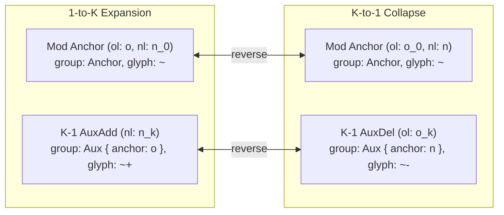

# Symmetric Collapse & Stepwise Invariant — Engineering Plan

- [x] Phase 1 — Symmetric Collapse Data Model & Auxiliary Deletion Emission (`assemble.rs`, `walk.rs`)
- [x] Phase 2 — Multi-line Token Slicing & Deletion Highlight Duality (`aux.rs`)
- [x] Phase 3 — Strict Stepwise Line Invariant & Wire Validation (`wire/hunk.rs`, `wire/row.rs`)
- [x] Phase 4 — Involution & Dual Reversal Verification (`golden.rs`, `row.rs`)
- [x] Phase 5 — Terminal & Markdown Rendering Verification (`diffuse-render`, `diffuse-tui`)
- [x] Phase 6 — Golden Acceptance Corpora & Global Sign-Off

---

## 1. Executive Summary

In `diffuse`, code modification groups pair pre-image and post-image changes:
- **1-to-$K$ Expansion**: transforms one old line into $K$ new lines. The engine emits 1 anchor modification row (`Row::Mod`, `RowGroup::Anchor`, gutter `~ `) followed by $K-1$ auxiliary addition rows (`Row::AuxAdd`, `RowGroup::Aux { anchor }`, gutter `~+`). Every line number on both sides is preserved in unbroken sequence.
- **$K$-to-1 Collapse**: transforms $K$ old lines into 1 new line. Previously, the engine merged $K$ deleted lines into a compound string on the first line and discarded the remaining $K-1$ lines from the output stream via `collapse_absorbed_dels`. This created line number gaps and broke mathematical symmetry.

This plan establishes full architectural symmetry and mathematical involution between Collapse and Expand:
1. **Symmetric Emission**: $K$-to-1 Collapse emits 1 anchor `Row::Mod` (`RowGroup::Anchor`, gutter `~ `) followed by $K-1$ auxiliary deletion rows (`Row::AuxDel`, `RowGroup::Aux { anchor }`, gutter `~-`). No pre-image or post-image line numbers are ever dropped.
2. **Mathematical Involution**:
   $$\text{expand.reverse()} \equiv \text{collapse}$$
   $$\text{collapse.reverse()} \equiv \text{expand}$$
   $$\text{row.reverse().reverse()} \equiv \text{row}$$
   The auxiliary deletion rows of a collapse render as the exact inverse of the auxiliary addition rows of the reversed collapse, including corresponding deletion and moved-source token highlights.
3. **Strict Stepwise Continuity Invariant**: Every line number sequence within a diff hunk must be strictly unbroken (`line.num == prev_line.num + 1` for both old and new lines) with zero gaps.



---

## 2. Table of Contents

1. [Phase 1 — Symmetric Collapse Data Model & Auxiliary Deletion Emission](#1-phase-1--symmetric-collapse-data-model--auxiliary-deletion-emission)
2. [Phase 2 — Multi-line Token Slicing & Deletion Highlight Duality](#2-phase-2--multi-line-token-slicing--deletion-highlight-duality)
3. [Phase 3 — Strict Stepwise Line Invariant & Wire Validation](#3-phase-3--strict-stepwise-line-invariant--wire-validation)
4. [Phase 4 — Involution & Dual Reversal Verification](#4-phase-4--involution--dual-reversal-verification)
5. [Phase 5 — Terminal & Markdown Rendering Verification](#5-phase-5--terminal--markdown-rendering-verification)
6. [Phase 6 — Golden Acceptance Corpora & Global Sign-Off](#6-phase-6--golden-acceptance-corpora--global-sign-off)

---

## 1. Phase 1 — Symmetric Collapse Data Model & Auxiliary Deletion Emission

### Objectives
Eliminate `collapse_absorbed_dels` so that $K$-to-1 Collapse preserves all $K$ old lines as distinct rows in the stream.

- **`crates/diffuse-core/src/collapse/assemble.rs`**:
  - Remove `collapse_absorbed_dels` dropping logic (`collapse_absorbed_dels.contains(&ri) => continue`).
  - For each collapse block `block_dels = [d_0, d_1, ..., d_{K-1}]` paired with `add_ri`:
    - Set the anchor row to pair `d_0` with `add_ri` as `Row::Mod` with `is_anchor = true` and `RowGroup::Anchor`.
    - For $k \in 1..K$, designate `d_k` as an auxiliary deletion: `del_groups.insert(d_k, RowGroup::Aux { anchor: anchor_num })`.
    - Retain `d_k` in `kept_dels` so that it is processed and emitted into the visual row walk.
- **`crates/diffuse-core/src/collapse/walk.rs`**:
  - Ensure `pass_sort_ordered_walk` emits `Row::AuxDel { anchor, line, spans, cached_runs }` for each auxiliary deletion immediately following the anchor or in sequential order with its anchor group.
  - Assert that all old lines $o_0, o_1, \dots, o_{K-1}$ are emitted with their respective line numbers without gaps.
- **Test-First Criteria**:
  - Author a unit test in `crates/diffuse-core/src/collapse/tests.rs` asserting that a 2-to-1 or 3-to-1 collapse emits exactly 1 `Row::Mod` (anchor) and $K-1$ `Row::AuxDel` rows carrying their true line numbers.

---

## 2. Phase 2 — Multi-line Token Slicing & Deletion Highlight Duality

### Objectives
Provide dual multi-line token slicing for Collapse auxiliary deletions matching Expansion auxiliary additions.

- **`crates/diffuse-core/src/collapse/aux.rs`**:
  - Implement `slice_multiline_del_runs` (the dual of `slice_multiline_runs`):
    - Given `full_del_runs` from aligning the joined old lines against `add.text()` and the individual old line texts `line_texts: &[&str]`:
    - Slice `full_del_runs` across line boundaries into:
      - `anchor_runs`: runs for the anchor row $d_0$.
      - `sliced: Vec<Vec<(RunKind, String)>>`: runs for each auxiliary deletion line $d_k$, converting matching context into `RunKind::MovedSrc` and non-matching text into `RunKind::Del`.
  - Distribute change spans (`Spans { del: ..., add: [] }`) for each `AuxDel` row.
- **Involution and Run Reversal**:
  - Verify that for any token run in an auxiliary deletion row:
    $$\text{run.kind.reverse()} = \begin{cases} \text{MovedTgt} & \text{if } \text{run.kind} = \text{MovedSrc} \\ \text{Add} & \text{if } \text{run.kind} = \text{Del} \end{cases}$$
- **Test-First Criteria**:
  - Unit tests verifying token span distribution across multi-line deletions and character count conservation across the collapse group.

---

## 3. Phase 3 — Strict Stepwise Line Invariant & Wire Validation

### Objectives
Enforce strict unbroken line number monotonicity across both old and new lines.

- **`crates/diffuse-core/src/wire/hunk.rs`**:
  - In `OutputHunk::validate_invariants_with_profile`:
    - Enforce strict stepwise new line monotonicity:
      ```rust
      if let Some(nl) = r.new_line {
          if let Some(prev) = last_new && nl != prev + 1 {
              return Err(format!("Hunk row {row_idx}: new_line non-stepwise: expected {}, got {nl}", prev + 1));
          }
          last_new = Some(nl);
      }
      ```
    - Enforce strict stepwise old line monotonicity within un-relocated runs:
      ```rust
      if let Some(ol) = r.old_line {
          if let Some(prev) = last_old && ol != prev + 1 {
              return Err(format!("Hunk row {row_idx}: old_line non-stepwise: expected {}, got {ol}", prev + 1));
          }
          last_old = Some(ol);
      }
      ```
    - Enforce complete old line coverage across the entire hunk:
      $$\{ \text{row.old\_line} \mid \text{row} \in \text{hunk.rows} \} \equiv \{\text{old\_start} \dots \text{old\_start} + \text{old\_count} - 1\}$$
      $$\{ \text{row.new\_line} \mid \text{row} \in \text{hunk.rows} \} \equiv \{\text{new\_start} \dots \text{new\_start} + \text{new\_count} - 1\}$$

---

## 4. Phase 4 — Involution & Dual Reversal Verification

### Objectives
Verify that reversing any expansion mod group produces the exact dual collapse mod group, and that double reversal is an exact identity.

- **`crates/diffuse/tests/golden.rs`**:
  - Extend `assert_diff_invariants` to assert mathematical involution on every mod group:
    - For every group with an `Anchor` row and associated `Aux` rows:
      ```rust
      let reversed_group = group.reverse();
      assert_eq!(reversed_group.reverse(), group, "Mod group involution failed");
      if group.is_expansion() {
          assert!(reversed_group.is_collapse(), "Expansion must reverse to Collapse");
      } else if group.is_collapse() {
          assert!(reversed_group.is_expansion(), "Collapse must reverse to Expansion");
      }
      ```
  - Verify that the apply oracle `apply_hunk_rows` succeeds on all reconstructed hunks using the old pre-image content.

---

## 5. Phase 5 — Terminal & Markdown Rendering Verification

### Objectives
Verify terminal rendering, gutter glyphs, and markdown diff output for symmetric collapse groups.

- **`crates/diffuse-render`**:
  - Ensure `~-` renders in the gutter for `(Some(RowGroup::Aux), RowKind::Del)`.
  - Ensure `~+` renders in the gutter for `(Some(RowGroup::Aux), RowKind::Add)`.
  - Ensure `~ ` renders in the gutter for `(Some(RowGroup::Anchor), RowKind::Mod)`.
  - Verify syntax highlighting and deletion background tints on `AuxDel` rows.
- **`crates/diffuse-tui`**:
  - Verify interactive navigation and expand-mod toggles (`Enter` / `e`) treat anchor and auxiliary rows coherently.

---

## 6. Phase 6 — Golden Acceptance Corpora & Global Sign-Off

### Objectives
Run the complete acceptance suite, update golden fixtures, inspect diffs per `tests/AGENTS.md`, and pass the verification gate.

- Run `scripts/check.sh` ensuring 100% test pass rate with zero clippy or rustfmt warnings.
- Update golden corpora where collapse rows previously swallowed lines:
  - Verify that missing old line gaps are eliminated.
  - Visually review wire and pager render diffs to confirm higher clarity and strict correctness.
- Pausing for user review and sign-off before committing.
